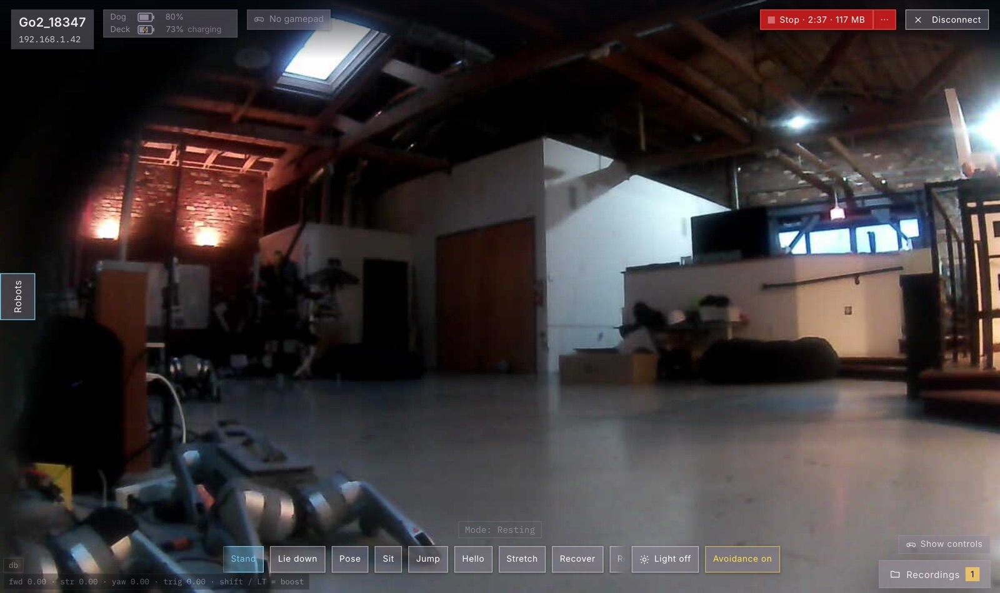
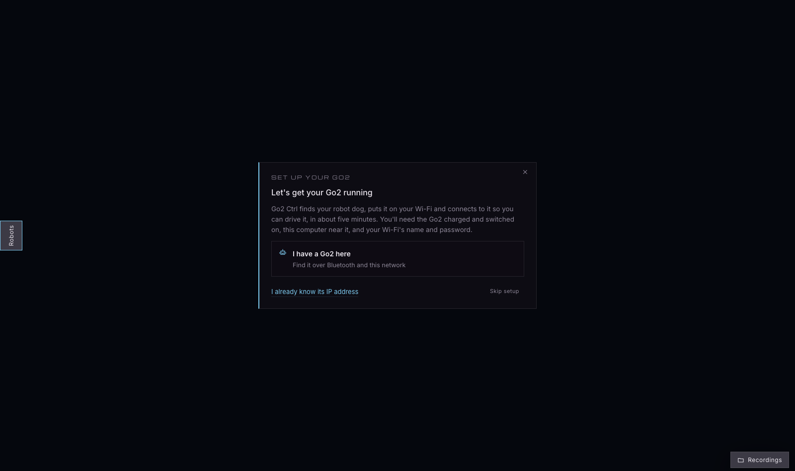
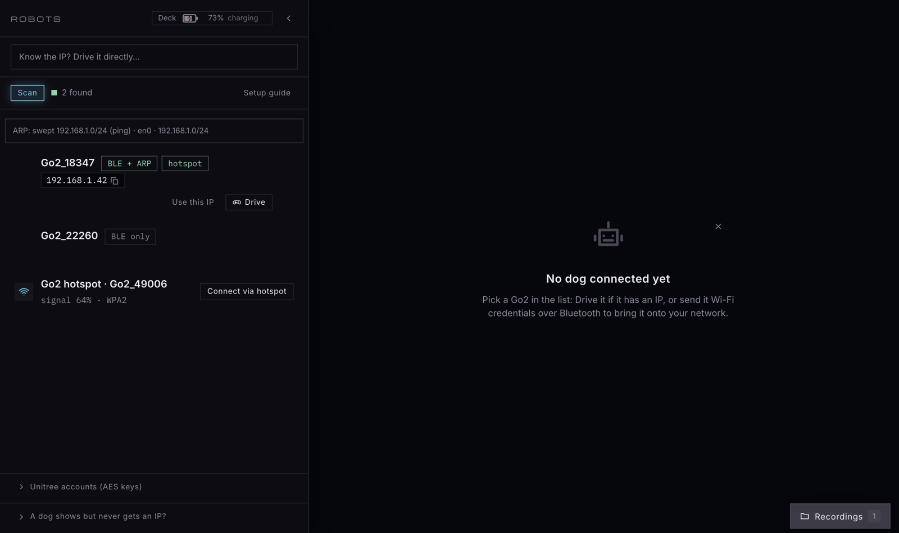

# Go2 Ctrl

Drive a Unitree Go2 from your laptop or Steam Deck. It's an app for [dimOS Desktop](https://github.com/dimensionalOS/dimos-desktop).



## What it does

- **Finds your dogs** over Bluetooth and the local network, and shows the hotspot of any Go2 nearby.
- **Puts a dog on your Wi-Fi** over Bluetooth. If you can't do that, it can join the dog's own hotspot.
- **Drives**: you get the camera, the usual tricks (stand, sit, hello, jump...), and a keyboard or gamepad.
  On a gamepad, B stops the dog, A resumes, and holding B for a second sits it down.
- **Records** every drive automatically, as a dimos memory store (`.db`) or an `.mcap`. Recordings upload to
  Dimensional's cloud unless you turn that off.

| First run | Finding dogs |
| --- | --- |
|  |  |

Newer Go2 firmware wants a per-robot AES key. Sign in to your Unitree account under "Unitree accounts" and the
app pulls the keys for every dog on it.

## Install

```sh
dimos-desktop install https://github.com/jeff-hykin/dim-go2-dash
```

## Develop

The backend is Rust (`backend/`) and the frontend is React (`frontend/`). `GO2_DASH_MOCK=1` fakes the robots,
Bluetooth and cloud, so you don't need a dog to work on it:

```sh
cd frontend && npm run build
cd backend && GO2_DASH_MOCK=1 cargo run -- --port 8787 --frontend ../frontend/dist
```

Every button is also an HTTP endpoint (listed under `agent:` in `dimos.yaml`), so Desktop's agent can do anything
you can. Checks: `cargo test`, `npm run typecheck`, `deno test frontend/test`, `deno task check-endpoints`.

Apache-2.0
